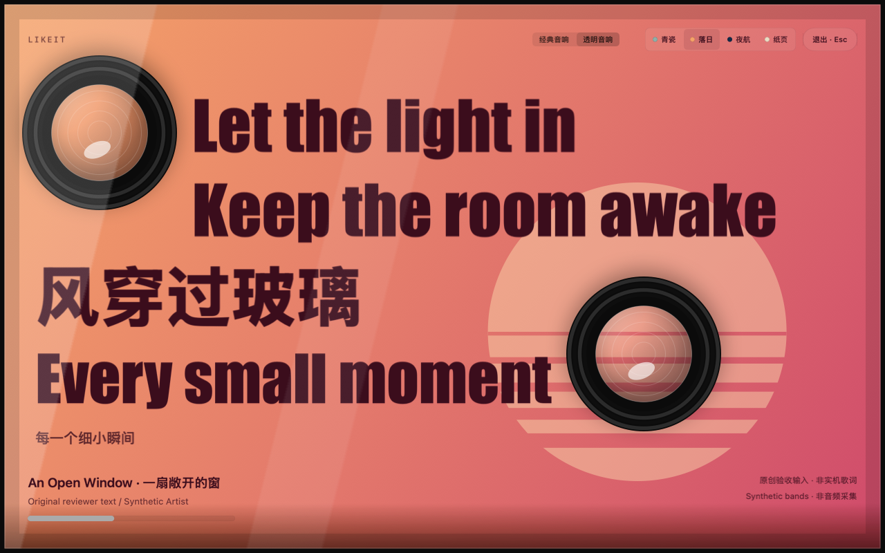
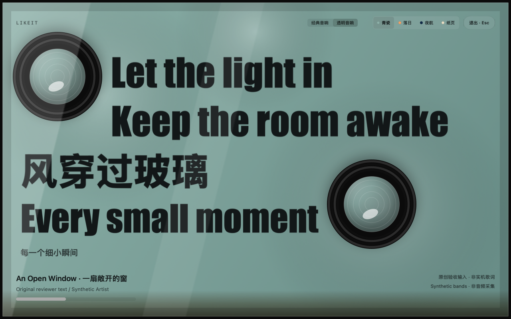
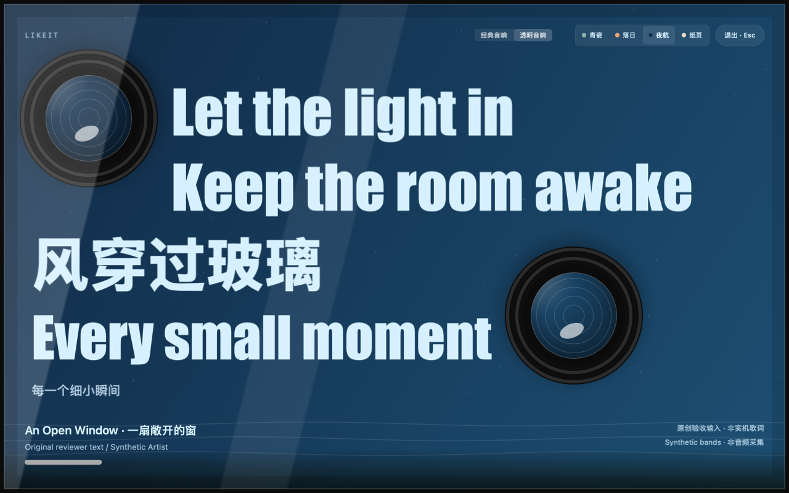
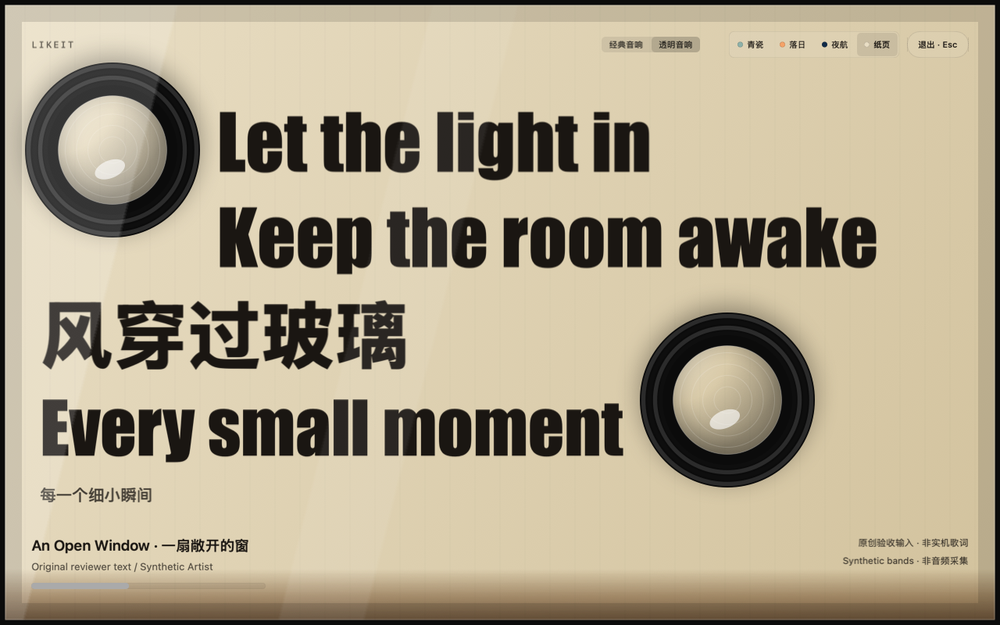
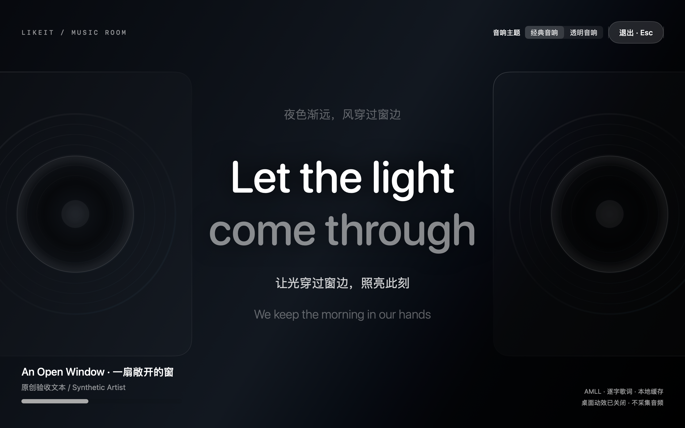

<div align="center">


# Likeit

**把正在听的歌，变成一张会呼吸的海报。**

网易云音乐 × macOS 音乐桌面 × Raycast 一键喜欢

[](https://github.com/AIDiscovery007/likeit/releases/latest)


[下载最新版](https://github.com/AIDiscovery007/likeit/releases/latest) · [快速开始](#快速开始) · [使用说明](docs/usage.md) · [反馈问题](https://github.com/AIDiscovery007/likeit/issues)

</div>



<p align="center"><sub>透明音响 · 落日</sub></p>

## 让音乐占满这一刻

全屏展开歌词，让透明音响随音乐起伏。想收下正在听的歌，唤起 Raycast，输入 <code>like</code> 即可继续手头的事。

| | 你会用到的功能 |
| --- | --- |
| **歌词海报** | 四行大字逐步呈现，搭配翻译与换页过渡；也支持普通同步歌词、逐字歌词和纯文本。实际展示取决于歌词来源。 |
| **随音乐律动** | 透明振膜、光环与场景响应网易云的低、中、高频能量。可跟随系统动效偏好，也可随时关闭。 |
| **四种氛围** | 青瓷、落日、夜航、纸页。主题与场景会记住你的选择。 |
| **自动找歌词** | 网易 → AMLL → LRCLIB 依次查找，成功结果本地缓存，重开可复用。 |
| **一键喜欢** | 从任意前台 app 唤起 Raycast，收藏网易云当前正在播放的歌。已喜欢保持原状，不切歌、不启动播放。 |
| **随时离开** | 按 Esc、Cmd+Q 或点击退出，音乐继续播放。 |

## 四种场景，各有心情

<table>
  <tr>
    <td width="50%"><br /><b>青瓷</b> · 柔和的绿，安静地听</td>
    <td width="50%"><br /><b>落日</b> · 把傍晚留在桌面</td>
  </tr>
  <tr>
    <td><br /><b>夜航</b> · 适合深夜的蓝</td>
    <td><br /><b>纸页</b> · 像翻开一本歌词集</td>
  </tr>
</table>

<details>
<summary><b>也可以回到经典音响</b> · 深色双音响与居中歌词</summary>



</details>

<sub>图片为实际 SwiftUI 界面的离屏渲染，使用原创演示歌词与合成频段；用于展示布局和主题，不代表实机播放或音频采集记录。</sub>

## 快速开始

### 先体验音乐桌面

1. 在 [Releases](https://github.com/AIDiscovery007/likeit/releases/latest) 下载 **Likeit-Desktop-v0.1.1-macos-universal.zip**。
2. 解压，把 **Likeit Desktop.app** 拖入“应用程序”，打开网易云并播放歌曲，再打开 Likeit Desktop。
3. 在右上角选择“透明音响”和喜欢的场景。允许系统音频访问后，音响会随音乐律动。

音乐桌面需要 **macOS 14.2+**。当前是未公证的早期版本，使用 ad-hoc 签名；macOS 可能阻止首次打开。确认下载来源后，可在“系统设置 → 隐私与安全性”使用系统提供的“仍要打开”。更新后可能需要重新授权。

### 加上 Raycast 一键喜欢

需要 **Raycast、Node.js 和 npm**。下载 Release 中的 **Likeit-Raycast-v0.1.1.zip** 并解压，在项目目录运行：

```sh
npm ci
npm run dev
```

在 Raycast 搜索 **Likeit** 打开音乐桌面，或搜索 **Like Current Track** 收藏当前歌曲。也可以在 Raycast 设置里给收藏命令配置 <code>like</code> 别名或全局快捷键。

收藏命令需要 **macOS 13+** 及辅助功能权限；音乐桌面的系统音频权限单独授权。发布包已带原生二进制，使用时无需 Xcode。当前通过 GitHub 分发，尚未上架 Raycast Store。

## 使用前知道这些

- 目前只支持 macOS 网易云音乐。歌曲身份或播放状态不明确时会提示原因，不执行收藏；成功提示表示客户端已确认喜欢，不保证云端同步。
- 音频仅在本机实时分析，不录制、不保存、不上传，也不采集麦克风。关闭桌面动效后停止音频采集。
- 歌词查询会向对应服务发送曲名及必要的歌手或歌曲 ID。官方 OpenAPI 配置是可选项，默认可使用公开歌词路径；无需把 token 或私钥放进项目。
- 已包含 Apple Silicon / Intel 通用二进制；Intel 实机与完整系统兼容矩阵仍待验证。系统媒体接口及在线歌词服务可能随版本变化。

详细权限、歌词配置、缓存位置及故障说明见 **[使用手册](docs/usage.md)**。

## 开发

```sh
git clone https://github.com/AIDiscovery007/likeit.git
cd likeit
npm ci
npm run dev
```

修改原生桌面后，使用 Apple Command Line Tools 与 Python 3 重新构建：

```sh
python3 scripts/build-desktop.py
npm run build
npm run lint
```

更多背景：[原生实现](docs/native-design.md) · [歌词与界面验收](docs/transparent-speaker-v3-review.md) · [开发约定](AGENTS.md)

## 致谢

[mediaremote-adapter](https://github.com/ungive/mediaremote-adapter) 提供媒体状态读取基础，[ConfettiSwiftUI](https://github.com/simibac/ConfettiSwiftUI) 提供收藏彩带效果。相关第三方许可证随源码和原生包保留。
